# Auditoría — 14 noviembre 2026 · antes y después

Producción: https://oscarbahamonde.com. Nuxt existente conservado. Inspección de código, HTML SSR y navegador real. Esta auditoría se escribió antes de modificar la implementación de esta fase.

| Requisito | Estado comprobado | Trabajo necesario |
|---|---|---|
| Nuxt/i18n/dock | Nuxt4, /es y /en, nueve secciones, tema e idioma funcionan | Conservar y verificar regresiones |
| Reserva S/20 | Handlers MercadoPago/Calendar preservados; tests8 pasan; webhook400 inválido; no transacción real | Mantener hashes; pago/Meet real pendiente |
| Home/Bio/foto/logo/precios | Existentes, precios coinciden con los nueve solicitados | Conservar copy y valores |
| A: hero y movimiento | Retrato grande, halo, reveal; sin panel chat, parallax/magnéticos limitados | Mejorar jerarquía, composición, reducción de movimiento |
| B: experiencia | Tres empresas; sin fechas/ubicación; Huawei/Telefónica solo en banda | Timeline/data JSON, fuentes, PNG/tono/contraste; datos no verificables pendientes |
| D: skills |12 iconos/texto sin grupos; Milvus comparte icono | Agrupar badges/iconos verificables |
| D: proyectos |3 SVG ilustrados, tags básicos | Evidencia visual, stacks/repos; impacto sin métricas inventadas |
| D: credenciales | Solo enlace LinkedIn | Recuperar fuentes y grid; nunca inventar fechas/verificación |
| C: interfaz | Chat incrustado con consentimiento obligatorio, texto plano y lanzador genérico | Panel flotante independiente, Markdown, sugerencias, grabación y acciones |
| C: backend | Lambda URL/SSE+ConverseStream,5 tools, DynamoDB/S3/KMS, OAuth secretos, Streams/DLQ/SNS | Conservar arquitectura y seguridad de efectos externos |
| C: consentimiento | Se exige para crear sesión y todas las tools; mensajes siempre se guardan | Sesión anónima sin persistencia de conversación hasta consentimiento explícito |
| C: modelo | KB solo servicios,800 tokens,30 turnos,temp0.2; topics restrictivos/HIGH | Contexto verificado ampliado, límites configurables, sin filtro temático por instrucción expresa |
| C: media | PDF/WebM/transcripción real y adjuntos Gmail comprobados | Poll cada2s supera límite12/min; corregir. Grabación mic/UI pendiente |
| C: notificaciones | Correos inicial/final reales; idempotencia comprobada en repetición; resumen alucina | Resumen respaldado por evidencia; Gmail no garantiza exactamente-una-vez ante timeout ambiguo |
| E: Medium | RSS10 entradas, parser descarta5 publicaciones en otros hosts; retenidas usan fallback | Normalizar URL Medium validada por guid, portadas/idioma/tags/extractos/paginación |
| F: robots | Accesible, bloquea API/pago/conectar y referencia sitemap | Conservar |
| F: sitemap | Dinámico, índices y rutas locales bilingües | Incluir todas las entradas RSS y lastmod/hreflang; Medium externo se documenta en llms (loc externo viola mismo host) |
| F: llms | llms.txt dinámico con precios y URLs local/Medium; falta full | Añadir llms-full y contenido ampliado |
| F: metadata | Canonical propio /es y /en; hreflang es/es-PE/en/en-US/x-default; OG correcto compartido | theme-color dual, BreadcrumbList y OG por post |
| G: consola | Sin errores/warnings en visita/cambio de tema e idioma capturados | Repetir después |
| G: Lighthouse | Última medición local94/100/100/100 móvil,100 desktop; último intento producción bloqueado por Chrome y PageSpeed429 | No afirmar95; repetir si entorno permite |
| G: pruebas asistente |17 tests y pruebas AWS/Gmail reales; falta batería30 | Añadir evaluación bilingüe y resultados medidos |

## Capturas iniciales
Ocho vistas del hero a1440×1000 y390×844, ambos idiomas/temas. Reveal requiere scroll: captura de toda la página sin recorrerla produce secciones ocultas y no representa un fallo de carga.

| | Claro | Oscuro |
|---|---|---|
| ES desktop | 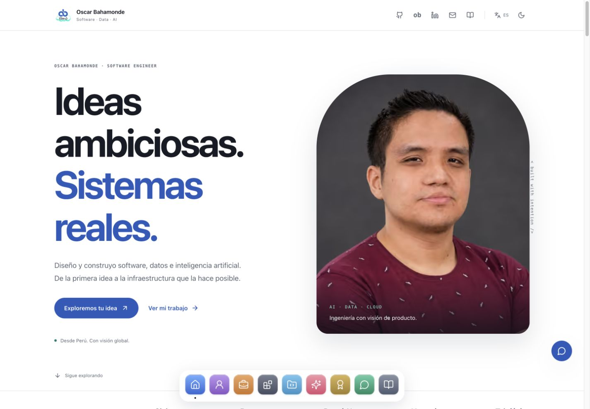 |  |
| ES móvil | 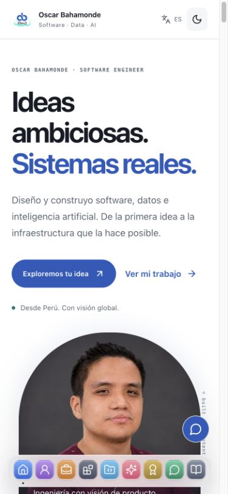 |  |
| EN desktop |  | 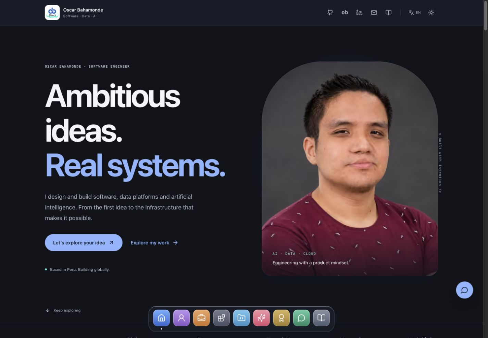 |
| EN móvil |  | 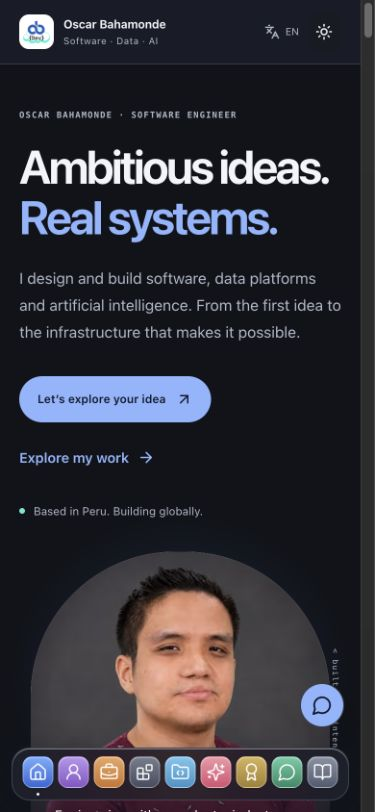 |

Fuentes: sitio y HTML archivado en docs/audit/before, repo actual, RSS Medium; LinkedIn indexado y Sessionize se documentarán por dato. Fechas laborales no verificadas. No se modifica contratación ni precios.

## Después — producción en Vercel y AWS

Frontend publicado `72495be0487f0a8c0376e621af08c362896f8a3b`; Vercel `dpl_Doc4vDVBvokqFzGR4Cf7za7ChwBX` READY, dominio raíz y www. AWS `oscar-assistant`, Guardrails v3. La evaluación y revisión final del backend se registran en TESTS.md.

| Área | Resultado observado |
|---|---|
| UI | Hero con retrato original, paleta y profundidad; headers numerados, animaciones reducidas según preferencia, cabecera social con etiquetas accesibles |
| i18n/tema/dock | 9 secciones; cambio ES/EN y tema sin recargar; tema/idioma conservados al recargar; sin overflow horizontal en los tamaños comprobados |
| Experiencia | 16 puestos del LinkedIn consultado, fechas reales y descripciones disponibles. PNG de13 hitos; Rayke/NETCOR sin logo verificable y freelance por nombre |
| Skills/proyectos/credenciales | 23 skills agrupadas; 3 capturas reales (VOZ y repositorios Quipubase/aiofauna); 29 credenciales expandibles con fechas y vencimientos |
| Asistente | Bot animado y panel flotante, cierre/reapertura conserva conversación; texto Markdown y respuesta Lambda real en ES/EN sin consentimiento previo |
| Consentimiento/correo | Solo se solicitó al pulsar Enviar a Oscar. Tras aceptar, se guardó y llegó a la bandeja del propietario la conversación QA-PORTFOLIO-1411 con transcript.txt (1987 bytes) |
| Contacto/reserva | 0 textareas en Contacto, CTA al panel y BookingFlow S/20. Los14 tests raíz incluyen invariancia de los handlers de agenda/pago |
| Medium | Todos los10 artículos disponibles en RSS,6+4 paginados,5 portadas reales; se conservan originales de publicaciones afiliadas a Medium |
| SEO | 54/54 comprobaciones aprobadas tras publicar:12 respuestas200, canonical/hreflang, Twitterimage, theme-color dual y20rutas de posts bilingües. llms y llms-full con10originales; extractos limpios. Evidencia: `docs/audit/after/seo-validation.json` |
| Consola | Sin errores de aplicación en navegación/tema/idioma y chat real anterior. Warning de limpieza Turnstile corregido y publicado; nueva sesión solicita desafío humano de Cloudflare, por lo que su comprobación final está pendiente. El iframe de Cloudflare emitió logs internos ofuscados: no se afirma cero errores de terceros |
| Contraste logos | Tono medido con Sharp; ajustes para Data&Analytics y Valtx. Intento de medir recortes reales rechazado por desalineación de captura: NO se usa para afirmar3:1. Playwright sigue pendiente por bloqueo de arranque local |

### Lighthouse real (PageSpeed Insights)

[Informe móvil](https://pagespeed.web.dev/analysis/https-oscarbahamonde-com-es/0szx5ye8rc?form_factor=mobile) · [Escritorio](https://pagespeed.web.dev/analysis/https-oscarbahamonde-com-es/0szx5ye8rc?form_factor=desktop). Medición pública de `/es`, 14noviembre2026,16:16America/Lima, Lighthouse13.6.0. No equivale a auditar todas las rutas/estados ni sustituye revisión manual WCAG.

| Dispositivo | Rendimiento | Accesibilidad | Buenas prácticas | SEO | CLS |
|---|---:|---:|---:|---:|---:|
| Móvil (Moto G Power,4G lento) |97|100|100|100|0|
| Escritorio |100|100|100|100|0|

Capturas y transcripción del informe en `docs/audit/after/lighthouse-{mobile,desktop}.{jpg,txt}`. El intento local de Chromium/Playwright falló antes de navegar por crashpad/Mach Permission denied1100; la medición remota resolvió Lighthouse, no la ejecución de Playwright.

### Capturas posteriores

Viewports CSS comprobados1440×1000 y390×844; el navegador devuelve imágenes1425×990 y375×812 por su superficie de captura. Dimensiones registradas en `capture-sizes.json`.

| | Claro | Oscuro |
|---|---|---|
| ES desktop | 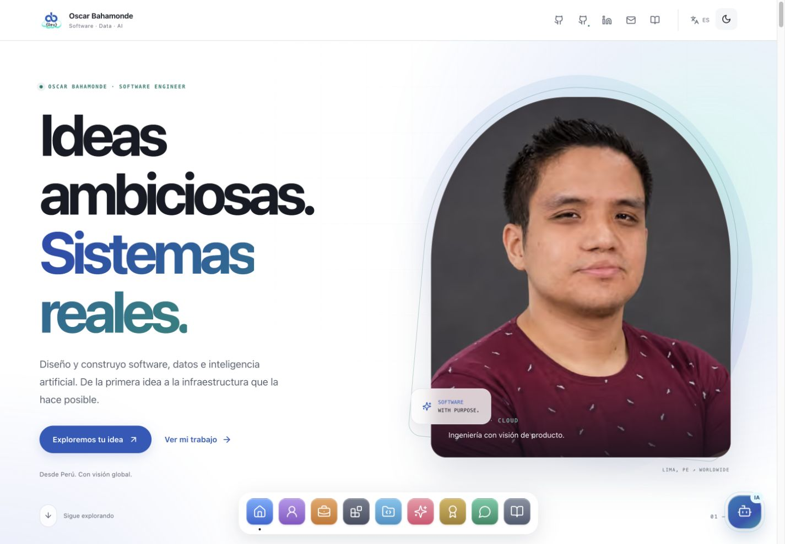 | 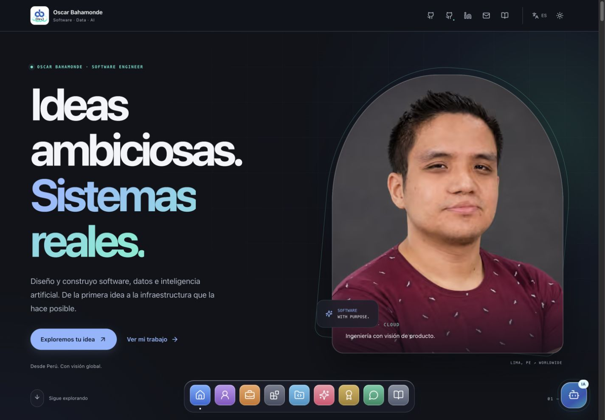 |
| ES móvil | 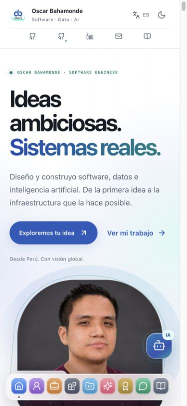 | 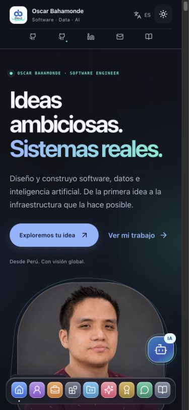 |
| EN desktop | 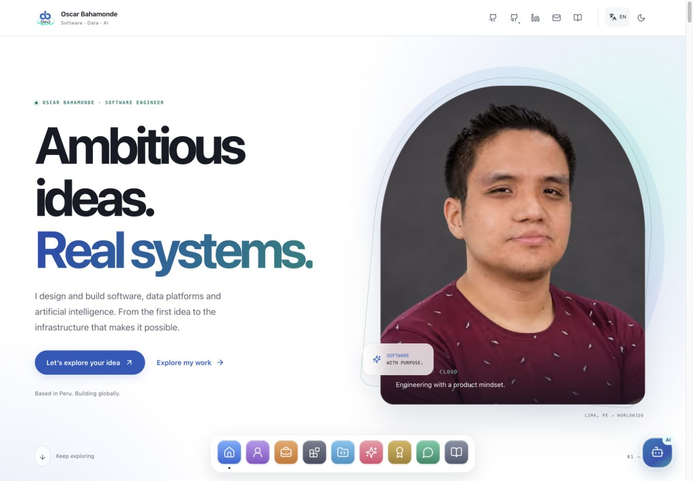 | 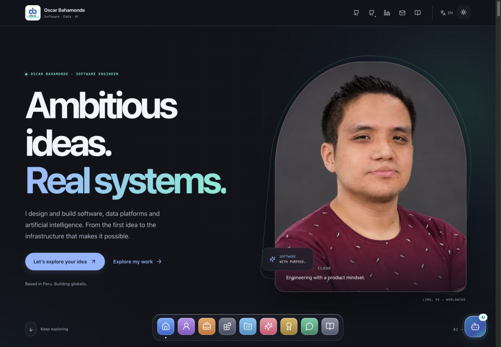 |
| EN móvil | 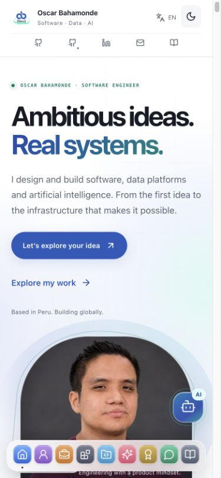 | 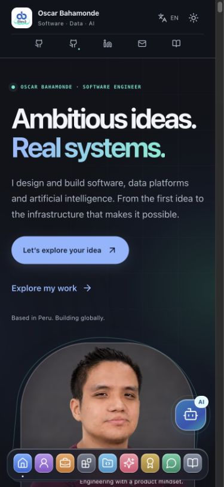 |

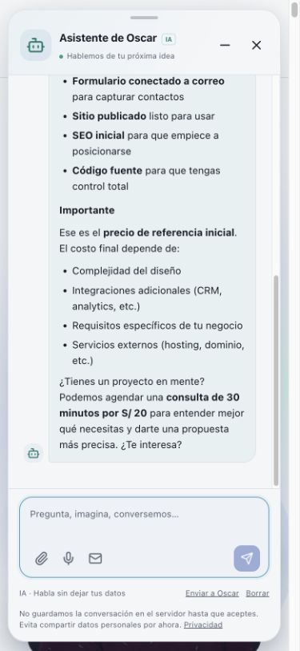
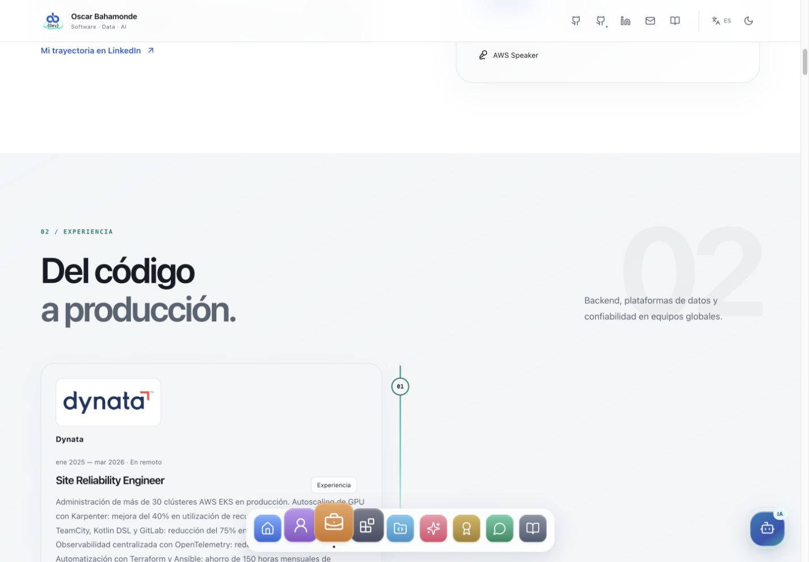

Pendientes explícitos: contraste renderizado/Playwright, grabación desde micrófono real y transacción S/20. Sin cobros ni eventos de prueba reales en esta fase. La evaluación semántica del asistente y sus intentos se conservan sin seleccionar solo respuestas favorables en TESTS.md.

Pruebas manuales complementarias en `docs/audit/after/manual-flows.json`:9/9 enlaces del dock,29 credenciales al expandir,10 posts al cargar más, servicio precargado en el panel, borrador conservado al cerrar/reabrir, Tab con foco visible y Escape devolviendo el foco al disparador. No sustituyen la suite Playwright.

