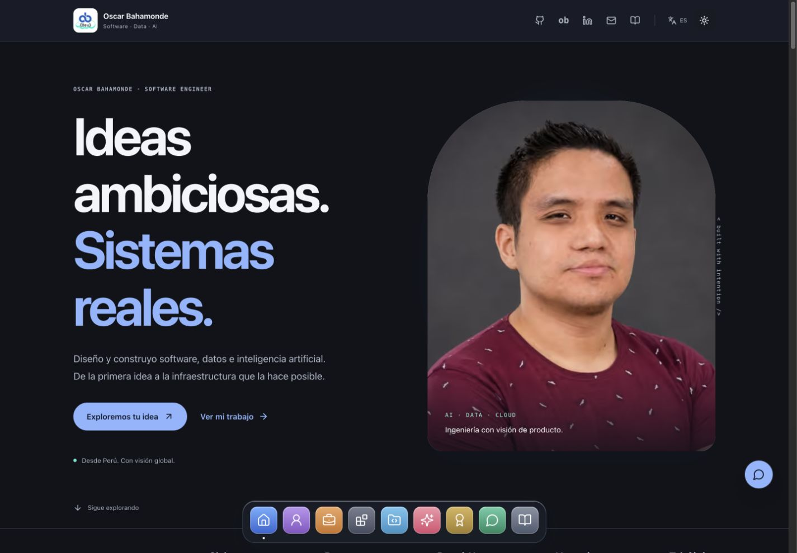
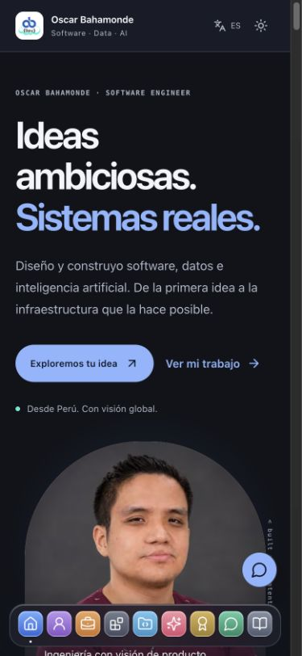
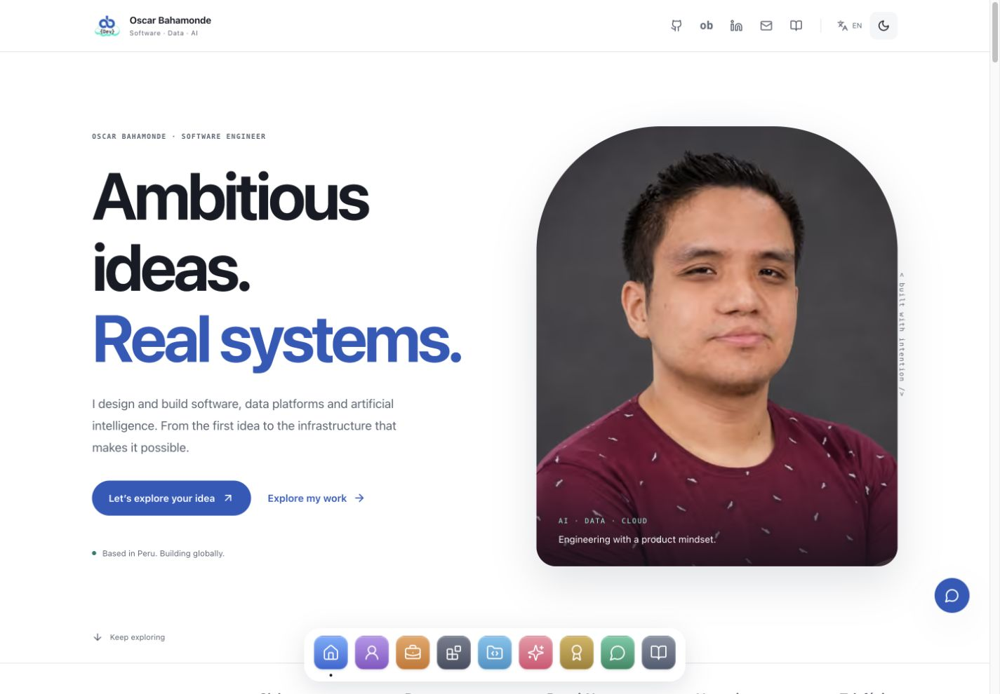
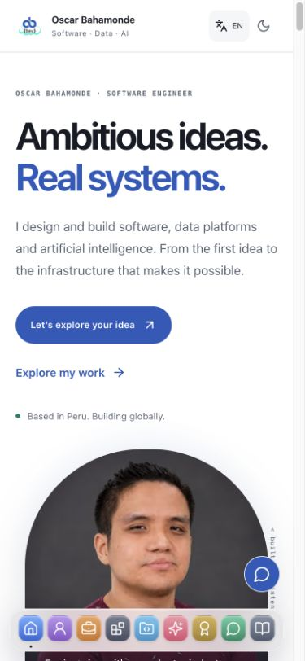

# Auditoría — 14 noviembre 2026 (antes de implementación)

Producción: https://oscarbahamonde.com. Nuxt existente conservado. Inspección de código, HTML SSR y navegador real. Esta auditoría se escribió antes de modificar la implementación de esta fase.

| Requisito | Estado comprobado | Trabajo necesario |
|---|---|---|
| Nuxt/i18n/dock | Nuxt4, /es y /en, nueve secciones, tema e idioma funcionan | Conservar y verificar regresiones |
| Reserva S/20 | Handlers MercadoPago/Calendar preservados; tests8 pasan; webhook400 inválido; no transacción real | Mantener hashes; pago/Meet real pendiente |
| Home/Bio/foto/logo/precios | Existentes, precios coinciden con los nueve solicitados | Conservar copy y valores |
| A: hero y movimiento | Retrato grande, halo, reveal; sin panel chat, parallax/magnéticos limitados | Mejorar jerarquía, composición, reducción de movimiento |
| B: experiencia | Tres empresas; sin fechas/ubicación; Huawei/Telefónica solo en banda | Timeline/data JSON, fuentes, PNG/tono/contraste; datos no verificables pendientes |
| D: skills |12 iconos/texto sin grupos; Milvus comparte icono | Agrupar badges/iconos verificables |
| D: proyectos |3 SVG ilustrados, tags básicos | Evidencia visual, stacks/repos; impacto sin métricas inventadas |
| D: credenciales | Solo enlace LinkedIn | Recuperar fuentes y grid; nunca inventar fechas/verificación |
| C: interfaz | Chat incrustado con consentimiento obligatorio, texto plano y lanzador genérico | Panel flotante independiente, Markdown, sugerencias, grabación y acciones |
| C: backend | Lambda URL/SSE+ConverseStream,5 tools, DynamoDB/S3/KMS, OAuth secretos, Streams/DLQ/SNS | Conservar arquitectura y seguridad de efectos externos |
| C: consentimiento | Se exige para crear sesión y todas las tools; mensajes siempre se guardan | Sesión anónima sin persistencia de conversación hasta consentimiento explícito |
| C: modelo | KB solo servicios,800 tokens,30 turnos,temp0.2; topics restrictivos/HIGH | Contexto verificado ampliado, límites configurables, sin filtro temático por instrucción expresa |
| C: media | PDF/WebM/transcripción real y adjuntos Gmail comprobados | Poll cada2s supera límite12/min; corregir. Grabación mic/UI pendiente |
| C: notificaciones | Correos inicial/final reales; idempotencia comprobada en repetición; resumen alucina | Resumen respaldado por evidencia; Gmail no garantiza exactamente-una-vez ante timeout ambiguo |
| E: Medium | RSS10 entradas, parser descarta5 publicaciones en otros hosts; retenidas usan fallback | Normalizar URL Medium validada por guid, portadas/idioma/tags/extractos/paginación |
| F: robots | Accesible, bloquea API/pago/conectar y referencia sitemap | Conservar |
| F: sitemap | Dinámico, índices y rutas locales bilingües | Incluir todas las entradas RSS y lastmod/hreflang; Medium externo se documenta en llms (loc externo viola mismo host) |
| F: llms | llms.txt dinámico con precios y URLs local/Medium; falta full | Añadir llms-full y contenido ampliado |
| F: metadata | Canonical propio /es y /en; hreflang es/es-PE/en/en-US/x-default; OG correcto compartido | theme-color dual, BreadcrumbList y OG por post |
| G: consola | Sin errores/warnings en visita/cambio de tema e idioma capturados | Repetir después |
| G: Lighthouse | Última medición local94/100/100/100 móvil,100 desktop; último intento producción bloqueado por Chrome y PageSpeed429 | No afirmar95; repetir si entorno permite |
| G: pruebas asistente |17 tests y pruebas AWS/Gmail reales; falta batería30 | Añadir evaluación bilingüe y resultados medidos |

## Capturas iniciales
Ocho vistas del hero a1440×1000 y390×844, ambos idiomas/temas. Reveal requiere scroll: captura de toda la página sin recorrerla produce secciones ocultas y no representa un fallo de carga.

| | Claro | Oscuro |
|---|---|---|
| ES desktop |  |  |
| ES móvil |  |  |
| EN desktop |  |  |
| EN móvil |  |  |

Fuentes: sitio y HTML archivado en docs/audit/before, repo actual, RSS Medium; LinkedIn indexado y Sessionize se documentarán por dato. Fechas laborales no verificadas. No se modifica contratación ni precios.

## Después
Pendiente implementación y mediciones; no sustituir evidencias por estimaciones.
